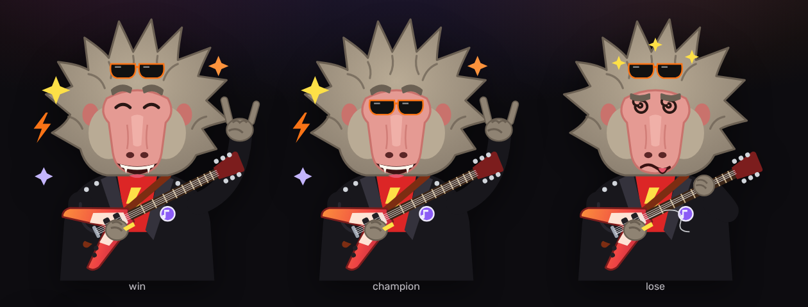

# Design e experiência

## Identidade visual

| Elemento | Decisão |
| --- | --- |
| Clima | Palco escuro com luzes: fundo grafite/preto com focos de luz roxos, vermelhos e laranja no topo da página. |
| Cores | Fundo `#0d0c10`, superfícies `#1b1822`/`#24202d`. Destaques: roxo `#8b5cf6`, vermelho `#f43f5e`, laranja `#f97316`. Gradiente de palco roxo → vermelho → laranja nos botões principais e no logotipo. |
| Cor por categoria | Rock vermelho, Pop magenta, Rap âmbar, Country laranja, Eletrônica ciano, Geral lilás. Aplicada no botão de play, na barra de progresso, nos cartões e no resultado. |
| Tipografia | **Bungee** (títulos e logotipo, estilo letreiro de casa de show) e **Rubik** variável (texto). Ambas OFL, servidas pelo próprio site via Fontsource (sem chamadas ao Google Fonts). |
| Formas | Cartões com cantos de 16–24 px, sombras discretas, faixa de luz colorida no topo de cada cartão de categoria. |
| Detalhes de palco | Reprodutor com textura de tela de amplificador, "VU" animado, botão iluminado como LED; vinil girando quando não há capa. |
| Movimento | Animações curtas (≤ 0,4 s) com `ease-out`; tudo é desativado com `prefers-reduced-motion`. |

## Mascote: Babuíno do Rock

Personagem original desenhado em SVG (`frontend/src/components/Mascot/Mascot.tsx`):

- **Silhueta:** juba espetada de roqueiro, rosto rosado com focinho alongado de babuíno,
  jaqueta de couro preta com tachas, camiseta vermelha com raio, broche de nota musical,
  guitarra Flying V laranja/vermelha e óculos escuros.
- **Variante cabeça** (`variant="head"`) para logotipo, favicon e ícones pequenos.
- **Sistema de humores** — o desenho é montado em camadas fixas (juba, rosto, jaqueta,
  guitarra) mais peças trocadas por humor (sobrancelhas, olhos, boca, braço, efeitos):

| Humor | Quando | Expressão |
| --- | --- | --- |
| `idle` | início | sorriso de canto, sobrancelha arqueada, pálpebras "de boa" |
| `listening` | trecho tocando | olhos fechados, notas musicais, cabeça balançando e mão palhetando |
| `doubt` | depois de um erro | sobrancelhas desencontradas, boca ondulada, "?" laranja, cabeça inclinada |
| `nervous` | 2 ou menos tentativas | olhos arregalados, dentes cerrados, gotas de suor, tremedeira |
| `win` | acerto | sorriso com presas, braço erguido fazendo 🤘, faíscas e raio, pulinho |
| `lose` | derrota | olhos em espiral, língua de fora, estrelinhas girando, corda da guitarra arrebentada |
| `champion` | resultado da vitória | óculos escuros no rosto, 🤘 e brilhos |

O mascote fica ao lado do reprodutor com um balão de fala que comenta a partida, sem cobrir
controles. Cada humor tem descrição acessível (`aria-label`).

## Telas

1. **Início** — logotipo, mascote em destaque, chamada "Ouviu? Adivinha!", número e data do
   desafio, botão para jogar a próxima categoria pendente, resumo (sequência atual, melhor
   sequência, progresso e pontos do dia, contagem para os próximos desafios), aviso de modo
   demonstração e os seis cartões de categoria com status (Novo, n/6, pontos ou derrota).
2. **Desafio** — categoria, número e data; mascote com balão; reprodutor (play/pause,
   barra com marcadores dos estágios, trechos liberados e bloqueados, volume, erros com
   "tentar de novo"); lista das 6 tentativas; campo com autocomplete; botões Pular e Confirmar.
3. **Resultado** (na mesma rota, quando a partida termina) — música e artista revelados, capa
   (quando o provedor fornece) ou vinil animado, link para a faixa completa, pontos, tentativas,
   grade de desempenho, compartilhar, contagem regressiva e atalhos para as outras categorias.
4. **Estatísticas** — filtros por categoria, 7 indicadores, gráfico de acertos por tentativa,
   cartões por gênero e histórico paginado.
5. **Como jogar** e **Sobre** (fontes musicais, privacidade, termos) e página 404.

## Componentes reutilizáveis

`Mascot`, `Layout` (cabeçalho, rodapé, aviso offline), `CategoryCard`, `AudioPlayer`,
`Attempts`, `GuessInput`, `ResultPanel`, `Loading`/`ErrorState`/`DemoBanner`, ícone
`CowboyHat`.

## Responsividade e mobile

- Layout em uma coluna até 900 px; duas colunas (palco | tentativas) no desktop.
- Alvos de toque ≥ 40–48 px; campo de resposta com fonte de 17 px (evita zoom no iOS),
  `enterkeyhint="send"` e rolagem automática para o centro ao focar.
- **Sugestões abrem para cima**, porque o teclado virtual ocupa a parte de baixo da tela.
- Menu vira só ícones no celular (com nomes acessíveis).
- Volume escondido quando o aparelho não permite controlá-lo (iOS).
- Testado em 390 × 844 (celular), 412 × 915 (Pixel 7, nos testes E2E) e 1280 px; os testes
  verificam que não há rolagem horizontal.

## Estados

Carregando (spinner com textos temáticos), erro com mascote em dúvida e botão "Tentar de novo",
sem conexão (faixa laranja no topo e campo de resposta desabilitado), sem resultados na busca
(mensagem e envio do texto digitado), falha de áudio (mensagem garantindo que a tentativa não
foi consumida), erro inesperado de interface (error boundary com botão recarregar).

## Acessibilidade

Link "pular para o conteúdo", combobox WAI-ARIA com navegação por setas, regiões
`aria-live` para o balão do mascote e o contador de tentativas, barra de progresso com
`role="progressbar"`, foco visível em âmbar, contraste alto e animações respeitando
`prefers-reduced-motion`.
